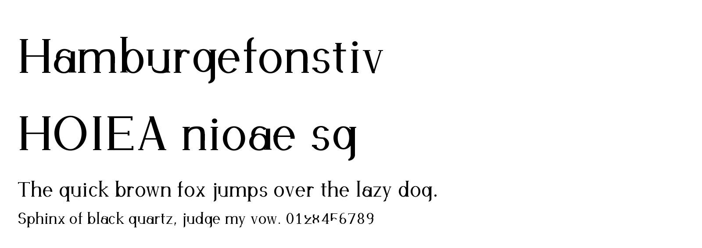

# Gswy Fonts

原创字体设计与实验室。项目包含两款独立开发的西文字体，以及一款用于设计对照的外部参考字体。

[在线字体实验室](https://gsvegetable.github.io/Gswy/) · [字体文件](fonts/) · [设计源文件](sources/) · [更新记录](CHANGELOG.md)



## 字体家族

### Gswy Serif — Regular

原创参数化过渡风格衬线体。以统一的笔画部件构建字形，适用于标题、短文与编辑排版。

- 版本：0.3.0
- 字符：208 个字形，包含拉丁字母、数字、标点及扩展字符
- 排版：47 组 OpenType GPOS 字偶距
- 格式：TTF、OTF、WOFF2

### Gswy Victorian Hand — Italic

独立的维多利亚时代书写风格实验款，灵感来自 1888 年伦敦书信与钢笔书写。基于原创字形轮廓进行约 10° 右倾与收窄处理，保留原有笔画对比。

这是手写感展示衬线体，不是完整的 Copperplate 连笔字体。与 Serif 分开构建、命名和发布。

- 格式：TTF、OTF、WOFF2
- 构建源码：[`sources/build_victorian_hand.py`](sources/build_victorian_hand.py)

### Pinyon Script — Roundhand Reference

外部圆体参考字体，用于观察传统 Roundhand 的连笔节奏与粗细对比。由 Nicole Fally 设计、Eben Sorkin 参与，来自 [Sorkin Type / Pinyon](https://github.com/SorkinType/Pinyon)。采用 SIL Open Font License 1.1。

Pinyon Script 通过 Google Fonts 在线加载，不属于 Gswy 原创字体，也不随本仓库重新打包；离线或网络受限时可能无法显示。

## 下载与使用

所有 Gswy 原创成品均位于 [`fonts/`](fonts/)：

| 字体 | 桌面安装 | 网页使用 |
| --- | --- | --- |
| Gswy Serif Regular | `GswySerif-Regular.ttf` / `.otf` | `GswySerif-Regular.woff2` |
| Victorian Hand Italic | `GswyVictorianHand-Italic.ttf` / `.otf` | `GswyVictorianHand-Italic.woff2` |

网页示例：

```css
@font-face {
  font-family: "Gswy Serif";
  src: url("./fonts/GswySerif-Regular.woff2") format("woff2");
  font-style: normal;
  font-weight: 400;
  font-display: swap;
}

@font-face {
  font-family: "Gswy Victorian Hand";
  src: url("./fonts/GswyVictorianHand-Italic.woff2") format("woff2");
  font-style: italic;
  font-weight: 400;
  font-display: swap;
}
```

## 在线字体实验室

打开 [Gswy Font Lab](https://gsvegetable.github.io/Gswy/) 可切换两款原创字体与 Pinyon Script 参考字体，输入自定义文字，并调整字号、行距和字距。支持预设样张、明暗主题及移动设备。

首次启用 Pages：进入仓库 **Settings → Pages → Build and deployment**，将 Source 设为 **GitHub Actions**。之后推送到 `main` 分支时，部署工作流会发布实验室和所需字体文件。

## 从源码构建

环境：Python 3.10+。

```bash
python -m pip install fonttools brotli pillow
python -m sources.gswy.build
python -m sources.build_victorian_hand
python -m sources.gswy.qa
```

构建输出：
- `fonts/`：两款原创字体的 TTF、OTF、WOFF2 成品
- `ufo/`：Gswy Serif 的 UFO 可编辑设计源
- `preview/`：构建预览图

可选样张渲染：

```bash
python -m sources.gswy.preview sample
python -m sources.gswy.preview grid abcdefghijklmnopqrstuvwxyz
```

## 项目结构

```
sources/
  gswy/                   Serif 字体参数、字形部件与构建工具
  build_victorian_hand.py Victorian Hand 构建脚本
fonts/                    字体成品
ufo/                      UFO 设计源
font-lab/                 在线字体实验室
specimen/                 Serif 字体样张页
docs/                     项目文档与样张
.github/workflows/        自动构建、检查与 Pages 部署
```

## 质量保障

`python -m sources.gswy.qa` 检查两款原创字体的 TTF、OTF、WOFF2：文件可解析性、字符映射、字形轮廓、字体命名、度量参数、GPOS kern 特性，以及 Victorian Hand 的斜体元数据。

GitHub Actions 在字体构建后运行质量检查；在线实验室部署会将两款原创字体一并打包。外部 Pinyon Script 的加载依赖 Google Fonts 网络服务，不属于本地构建检查范围。

## 许可

Gswy 原创字体软件采用 [SIL Open Font License 1.1](LICENSE)。可自由使用、嵌入、修改与再分发，具体以许可证文本为准。

Copyright 2026 The Gswy Serif Project Authors.
